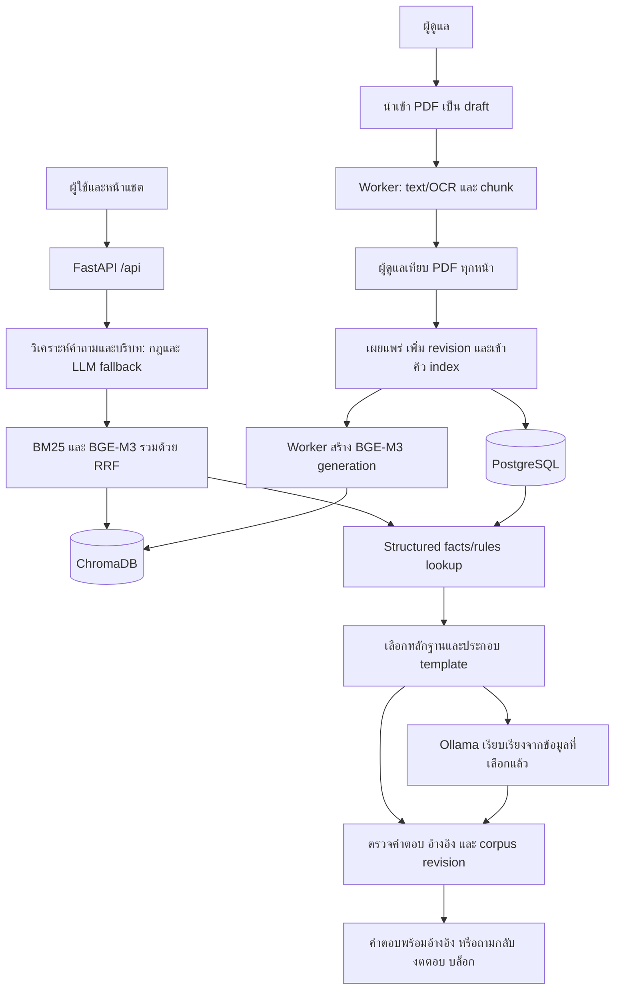

# สถาปัตยกรรม RISE

FastAPI เป็น Modular Monolith มีบริการถามตอบชุดเดียวและ worker แยก process ใช้ PostgreSQL เป็นแหล่งข้อมูลหลัก ChromaDB เป็น vector store และ private filesystem เก็บ PDF `app/bootstrap.py` ประกอบ adapters ตาม lifecycle โดยไม่ใช้ legacy HTTP app

API ทั้งหมดใช้ `/api/*` หน้าแชตส่งคำถามไป `/api/query` โดยไม่มี persona สมมติ `QueryService` โหลด corpus snapshot หนึ่งรุ่น วิเคราะห์คำถามและค้นด้วยข้อความที่แก้บริบทแล้ว ข้อความที่ใช้ตอบต้องมาจากฉบับเผยแพร่และตรวจแล้ว facts/rules ต้องมีหลักฐานที่ใช้ได้

ตัวเลขที่เหมือนกันแต่ผูกผิดทุน ชั้น ปี หน่วย หรือประเภทวงเงินยังถือว่าผิด Candidate ต้องรักษาข้อความสำคัญจาก template หากตรวจไม่ผ่านหรือโมเดลล้มเหลวใช้ template สำรอง ไม่มีข้อความที่ระบบสร้างเองถูกเติมกลับเป็น evidence หาก corpus เปลี่ยนระหว่างตอบจะบล็อก

`processing` บอกการใช้ LLM ในขั้นวิเคราะห์และเรียบเรียงแยกกัน พร้อมชื่อโมเดล วิธีค้น และ fallback จริง การค้นเวกเตอร์ไม่ขึ้นกับการเปิด LLM เมื่อ index หรือ embedding ไม่พร้อมจะใช้ BM25 งบงานโมเดลรวม 35 วินาทีต่อคำถาม

การเผยแพร่ version ใหม่และแทน version เก่าเป็น transaction เดียว จากนั้น worker สร้าง index ภายหลัง เปิด generation เมื่อ revision ยังตรง ระหว่างนั้น BM25 ใช้งานได้ citation เก็บ document/version/page/chunk และเปิด PDF ต้นฉบับได้

JSON และ engine เดิมมีไว้สำหรับ fixtures/งานวิจัย offline ไม่ถูก mount เป็น HTTP runtime ไม่มี JSON demo fallback เมื่อไม่ตั้งฐานข้อมูล HTML และ CoC personnel database ยังเป็นแผนระยะถัดไป
