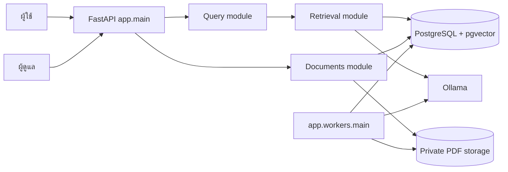

# สถาปัตยกรรม RISE

RISE เป็น Modular Monolith ที่ประกอบ FastAPI, worker, PostgreSQL 17 + pgvector, private file storage และ Ollama ใน process boundaries ที่ชัดเจน `app/bootstrap.py` ประกอบ adapters ครั้งเดียวต่อ process ส่วน modules เก็บกฎและ application flow โดยไม่เปิด connection ตอน import

`modules/query` วิเคราะห์คำถาม resolve persona ของ v1 เลือกหลักฐาน ประกอบคำตอบ และตรวจคำตอบ; `modules/knowledge` ดูแล facts, rules, corpus context และ citation; `modules/retrieval` รวม BM25 กับ semantic score ผ่าน RRF; `modules/documents` ดูแล PDF, chunk, review และ publication; `modules/legacy` รักษา HTTP contract `/v1`, admin UI และ SSE เดิม

Adapters อยู่ใต้ `infrastructure`: PostgreSQL/pgvector เป็น runtime หลัก, Ollama ให้ Qwen3 และ BGE-M3, filesystem เก็บ PDF แบบ private และ JSON ใช้เฉพาะ compatibility/fixtures เส้นทาง v2 เรียก repository/application service โดยตรงและไม่ย้อนกลับไปใช้ HTTP หรือ schema ของ legacy

Publication ต้องมี human review เสมอ Draft, OCR และ model output ไม่ทำให้ข้อมูลกลายเป็นหลักฐานที่อนุมัติ การ publish version ใหม่จะเตรียม index แล้ว activate พร้อม supersede version เดิมใน transaction เดียว Historical version ยังคงเปิดผ่าน citation แบบ version/page ได้ แต่ version ที่ superseded หรือ withdrawn จะไม่อยู่ใน current retrieval

หาก Ollama ใช้งานไม่ได้ query ยังใช้ BM25 และ verified template ได้ Candidate จาก LLM จะถูกทิ้งเมื่อ timeout, corpus เปลี่ยนระหว่างตอบ หรือไม่ผ่านการตรวจตัวเลข ปีงบ ชื่อทุน เงื่อนไข และ citation
