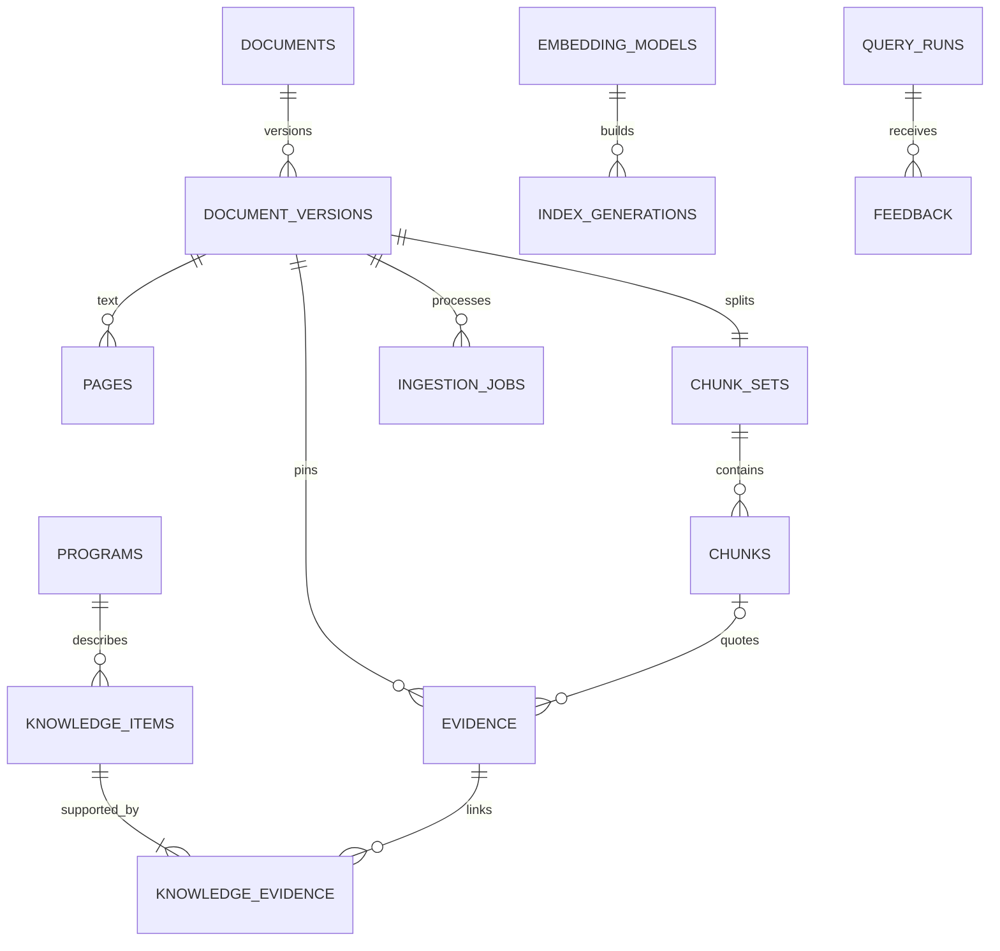

# PostgreSQL model

The executable schema is [models.py](../app/infrastructure/postgres/models.py) and Alembic revision `0001_rise`. PostgreSQL 17 stores relational data; ChromaDB stores vectors. No vector extension is required.

| Schema | Tables |
|---|---|
| core | programs, annual_calls, tiers, aliases, personas, knowledge_items |
| knowledge | documents, document_versions, pages, chunk_sets, chunks, evidence, knowledge_evidence |
| retrieval | corpus_revision, embedding_models, index_generations |
| audit | ingestion_jobs, events, import_runs, query_runs, feedback |

UUIDs are internal IDs; nullable unique legacy_id fields preserve old references. Facts and rules share a knowledge table with distinct kind and validation. Decimal monetary values use numeric(14,2); Gregorian timestamps are timezone-aware and Buddhist fiscal years use explicit fiscal_year_be names. Normalized program/call/tier links support scoped selection while JSON payloads retain original metadata and rule conditions.

A partial unique index allows one current version per document. Publication, withdrawal and review decisions change the corpus revision. ChromaDB generations use 1024-dimensional BGE-M3 vectors with HNSW cosine search. A complete generation for the current corpus revision is required before activation. SQL search still enforces current/published/verified filters.

PDF bytes live outside the DB in a private named volume, addressed by SHA-256. Import manifests hash JSON and original PDFs. Reimport only inserts missing records and preserves reviewer changes. Existing source verification is preserved; no script assigns a new reviewer. Legacy rule provenance retains its original document-review gate.
